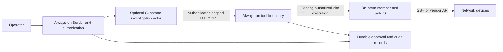

# Agent Substrate assessment — 2026-10-07

## Decision

**NO-GO for integrating Substrate into current NetClaw / Risk of Claws.** Cloud portability is a worthwhile separate goal. Substrate is a credible technology for a different workload shape: numerous stateful sessions that spend substantial time inactive. NetClaw's device access and durable mesh are a poor direct fit; separating them requires new infrastructure and security work before any savings are established.

This is an inference from inspected contracts and NetClaw source, not a failed installation benchmark. The owner explicitly preferred stopping if the fit was poor. No runtime experiment was built or deployed.

## Evidence baseline

NetClaw source: `95bb17e27a6a2538fcb0168d0b1d0ab5bbe34692` (1.5.0).
Core Substrate source: `92b74c0ee45aee6578a1a3d468f9f56b95074050`, inspected from a public clone. Links below pin this revision where possible; GKE and kagent pages describe their own distributions, not guaranteed equivalents.

| Source | Verified evidence | Consequence for this decision |
| --- | --- | --- |
| [Core README](https://github.com/agent-substrate/substrate/blob/92b74c0ee45aee6578a1a3d468f9f56b95074050/README.md) | Kubernetes-backed actors/workers, OCI workload support, pre-1.0 API instability; published density/latency claims | Real project, but no NetClaw performance result and no compatibility guarantee |
| [Core egress contract](https://github.com/agent-substrate/substrate/blob/92b74c0ee45aee6578a1a3d468f9f56b95074050/docs/egress-traffic.md) | HTTP(S) supported; WebSocket, ordinary CONNECT and other TCP blocked; DNS exceptions, other UDP/non-TCP traffic blocked | Direct pyATS SSH and existing federation cannot simply move inside actors |
| [API guide](https://github.com/agent-substrate/substrate/blob/92b74c0ee45aee6578a1a3d468f9f56b95074050/docs/api-guide.md), [counter example](https://github.com/agent-substrate/substrate/blob/92b74c0ee45aee6578a1a3d468f9f56b95074050/demos/counter/README.md) | WorkerPool is a Kubernetes CRD; ActorTemplate lives in an atespace and uses the ate API; full versus data snapshot scopes differ | Do not invent an ActorTemplate Kubernetes manifest or equate file persistence with RAM restore |
| [GKE documentation](https://docs.cloud.google.com/kubernetes-engine/ai-ml/about-agent-substrate) | Evaluation available; production support allowlisted; open network connections not preserved; GCS required; documented egress-policy/credential-injection limitations differ from core | Do not assume upstream-main security features apply to the GKE package; reconnect and reauthorize after resume |
| [kagent integration](https://kagent.dev/blog/kagent-agent-substrate-sandboxes), [installation](https://kagent.dev/docs/kagent/1.x/setup/installation/) | Concrete integration with its own harness/agent lifecycle | Evidence of ecosystem investment, not evidence of NetClaw/OpenClaw compatibility |

The core egress document labels itself a GA contract. These are its documented supported protocols at the pinned revision, not traffic measurements from this session. Source documentation and managed-distribution behavior must be verified again before deployment. A threat-model mitigation or roadmap entry is not proof a control is implemented.

## Is this where the industry is going?

There is credible movement toward isolated agent execution, warm capacity, and separating a session from a pod: Google's GKE offering and kagent's integration are concrete examples. They establish a direction, not an industry-wide consensus or a requirement for all agent applications. They are also connected ecosystem signals, not independent adoption statistics.

Substrate solves **execution density and lifecycle**, not network management, agent reasoning, fleet authorization, or site connectivity. kagent is optional; replacing OpenClaw with another harness would be a separate product decision. NetClaw does not need either project merely to run on a VM or in ordinary containers.

## Fit against actual NetClaw

| Workload | Placement recommendation | Reason |
| --- | --- | --- |
| Border, NCFED/iN2N transport and member liveness | Current always-on runtime | Framed transport, TLS identity/channel binding and heartbeat loops are operational state |
| pyATS, Junos and multivendor device execution | Site-local always-on executor | SSH/NETCONF reachability, host trust, inventory, credential scopes, task results and uncertain outcomes |
| Syslog, SNMP traps, IPFIX and subscriptions | Site-local durable receiver | Must accept unsolicited traffic continuously; hibernation is not a collector lifecycle |
| Offline parsing, report preparation, bounded analysis | Possible future actor candidate | Can use supplied approved data with bounded requests; still needs measured idle density |
| Human investigation/conversation state | Possible future actor candidate behind an adapter | Needs authenticated HTTP entry, reconnect-aware clients and external authoritative approval/audit state |
| Small continuously active Risk | Keep current runtime; evaluate ordinary containers separately | Warm workers and added control plane can erase multiplexing savings |

Relevant repository evidence:

- [internal_channel.py](../../mcp-servers/protocol-mcp/bgp/federation/internal_channel.py): member-initiated custom framing with pinned identity and TLS channel binding.
- [channel.py](../../mcp-servers/protocol-mcp/bgp/federation/channel.py): persistent reader/heartbeat/dispatch loops.
- [invocation.py](../../mcp-servers/protocol-mcp/bgp/federation/invocation.py): OpenClaw gateway delegation uses its CLI/WebSocket path. A gateway colocated inside a sandbox is a different design from an actor reaching it externally; neither is proven here.
- [in2n-services.py](../../scripts/in2n-services.py): durable services and host-level confinement. Kubernetes/gVisor cannot automatically satisfy those existing probes.
- [MCP Tasks](../../docs/MCP-TASKS.md): pyATS completed-result persistence, single-process DB ownership, and unknown-outcome recovery already have explicit semantics. Snapshot restore cannot silently replace them.

## How pyATS reaches on-premises infrastructure

pyATS initiates ordinary device connections from wherever its process runs. It needs a supported Python/dependency platform, device DNS/IP reachability, return routing/NAT, permitted ports, credentials and verified host identity. Kubernetes creates no route into a private network by itself. [Kubernetes network model](https://kubernetes.io/docs/concepts/cluster-administration/networking/) and [NetworkPolicy](https://kubernetes.io/docs/concepts/services-networking/network-policies/) explain the cluster/policy layers; the WAN path is separate.

Three deployment choices remain viable architectural options, subject to their own validation:

1. **All on-premises:** host or ordinary Kubernetes deployment in a routed management zone. Scope egress to approved device addresses/ports; provision persistent data and per-member secrets. This avoids exporting private network data.
2. **Hybrid Risk:** keep device-facing members on-premises and place selected coordination/analysis services in cloud. Existing members initiate their verified TLS connection to Border; allow the actual federation transport through the firewall, not an assumed HTTPS ingress. A cloud Border receives delegated content, so data minimization and disclosure authorization remain necessary. A future Substrate actor would need an HTTP adapter outside this transport.
3. **Cloud executor over private connectivity:** ordinary VM/pod → VPN or private circuit → management network → device. Verify both routing directions, overlapping CIDRs, DNS, MTU, firewall/source NAT behavior and device AAA/source ACLs. A separate bastion must be explicitly configured and supported. No public router SSH exposure is needed. This changes credential/data placement and needs approval. A VPN does **not** make blocked actor SSH supported.

If revisited, the proposed separation is:

The tool boundary and actor adapter above **do not exist as a completed integration in this branch**. Actor route headers are not credentials; atespace/actor UID must bind to trusted tenant/Risk/member/device authorization. Keep raw configs, secrets and topology local unless explicitly approved for a destination. Snapshot storage is another copy of potentially sensitive data, not merely infrastructure metadata.

## Resume is not transaction recovery

RAM/files restored from a snapshot cannot restore a remote SSH server's socket, undo a device change, extend an approval, or make stale evidence current. Future integration needs reconnects, refreshed credentials/authorization, external durable operation IDs, single-owner fencing, and reconciliation of uncertain results. Cloning or rolling back an actor must never duplicate a configuration action. Retain ServiceNow/explicit Terminal Intent Local/Lab controls and GAIT; a sandbox is not change approval.

## Reopening gates

Reconsider only after observing enough idle sessions to support a cost case, identifying a bounded HTTP-compatible workload, and selecting an exact supported runtime/distribution. Benchmark total cost against current services and ordinary Kubernetes, including warm-worker minimums, control plane, snapshot storage/I/O, connectivity, logs and operations. The advertised sub-second wakeup excludes NetClaw tool/model latency and is not a user-response SLO.

A possible future target is at least 25% total-cost improvement with an operator-agreed p95 response budget and no authorization/recovery regressions. This is a proposed decision threshold, **not a measured result**. Start with local synthetic data, then authorized read-only site access; production only after isolation, durable audit, failure/reconnect and rollback acceptance. Until those gates are met, avoid the integration.
