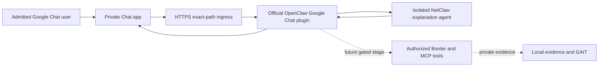

# Implementation Plan: Google Chat channel

Status: draft; no runtime patch or deployment in this spec-writing session.

## Architecture

Reuse the official channel's token verification, event translation and delivery.
Keep the runtime gateway loopback/private. No new public HUD route, custom webhook
handler or duplicate Google API client is planned. A future operational stage
requires enforceable egress filtering before binding to the operational agent.

## Phase 0 — Compatibility and baseline

Capture current source/runtime version, plugin state, selected agent and redacted
config topology. Do not print tokens or copy raw runtime config into the repo.
Evaluate a pinned compatible pair in an isolated test runtime; check package peer
ranges, plugin load, channel schema and SDK APIs. The observed July host is not
proven compatible with either candidate from research. If upgrading, take private
backups and review migration/restart impact before changing the active instance.

## Phase 1 — Repeatable setup

Proposed `scripts/googlechat-setup.py` is dry-run/read-only by default. It validates
an existing credential path, version pair, HTTPS audience, exact webhook path,
stable allowlist IDs and isolated agent binding. It prints a redacted config diff
and missing prerequisites. An explicit apply mode writes atomically with private
backup and preserves all other channels/agents. It never creates Google resources,
activates public ingress, upgrades OpenClaw or sends test messages implicitly.

Proposed `config/channels/googlechat.example.json` contains only placeholders,
disabled enablement and path-based credentials. Validate against the chosen
plugin's schema. Pin the installation command after tests; do not invent a
minimum version from a date label. Use native CLI for channel status/probe.

## Phase 2 — Policy and presentation

Pilot profile uses separate public bootstrap, all-tools-denied agent, stable IDs,
explicit spaces, mention gating, bot rejection, isolated DMs and thread replies.
Tests must prove the runtime does not inject private global context. Session
isolation does not by itself isolate files or tools.

Add a small authenticated HUD Channels status view with redacted readiness and
links to local documentation. No credentials in browser forms or public responses.
Operational mode remains unavailable in the pilot; a later reviewed implementation
must enforce identity/task authorization and deterministic egress at code boundaries.
Keep provider transport approvals distinct from change-management approval.

## Phase 3 — Acceptance and lifecycle

Use sanitized event fixtures for negative token/audience/identity/replay tests.
Exercise proxy path rejection, two-user DM isolation, space/thread behavior,
revocation, retries, unavailable gateway and disabled channel. Then run the
owner-selected synthetic live pilot and record measured response/delivery results.
Verify disablement and rollback. No feature version bump until implementation and
applicable acceptance are complete.

## Artifact coherence

| Surface | Planned treatment |
|---|---|
| README, SOUL, TOOLS, guide | Describe native channel, policy, observed compatibility and limits |
| Installer catalog/install function | Optional channel component; explicit setup, no hidden upgrade or activation |
| `.env.example` | `GOOGLE_CHAT_SERVICE_ACCOUNT_FILE` path only, no secret value |
| Runtime config | Merge channel/agent binding only after validated explicit apply |
| `config/openclaw.json` MCP registry | No new entry: transport is an official OpenClaw channel, not a new tool server |
| Catalog/inventory checkers | Account for optional channel; do not inflate MCP count |
| HUD | Readiness/status with no secrets |
| Skill | `workspace/skills/googlechat-channel/SKILL.md` for setup/use/recovery |
| Tests | Compatible-pair, config-preservation, policy, ingress and delivery tests |
| Audit and release | GAIT, local daily notes, verified evidence; minor release on completed feature |

## Constitution check

Native-channel transport follows the existing OpenClaw channel pattern; it does
not add a non-MCP device/tool integration. All network operations remain in existing
MCP services and approvals. Path-based service credentials stay in private runtime
storage; environment contains only the path. SDD artifacts are drafted before
implementation. No public exposure or messaging is authorized by this design.
